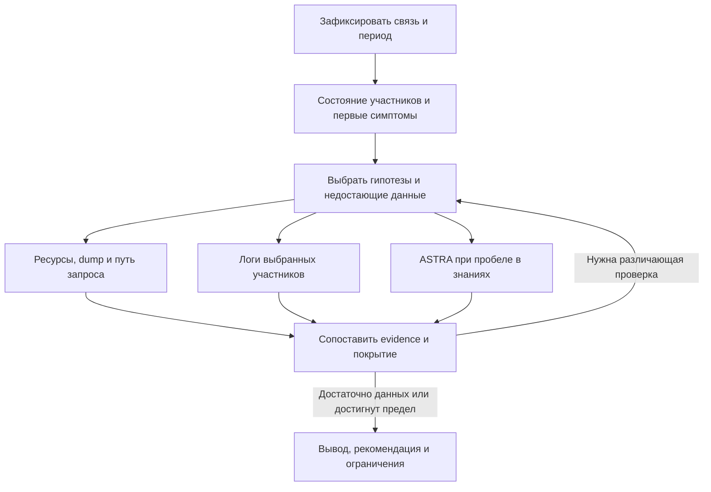

# Предложения по улучшению алгоритма Istio Diagnostics MCP

Дата: 23 октября 2026 года.  
Статус: авторское предложение для обсуждения. Это не описание завершённой реализации и не окончательная API-спецификация.

Основание: [разбор монолога](01-transcript-analysis.md), предыдущие решения проекта, пример неудачных MCP-вызовов и текущая документация репозитория на коммите `3a54e3f`.

## 1. Рекомендуемая архитектура

Сохранить Go MCP-сервер как слой получения, нормализации и проверки данных. Клиентскому агенту поручить выбор гипотез, координацию сабагентов и объяснение результата. Отдельную LLM внутри сервера пока не добавлять.

Организовать исследование вокруг конкретной связи и проверяемых гипотез. Следующий шаг выбирается по тому, какие данные помогут различить оставшиеся причины. Это позволяет обнаружить простой конфликт портов быстро и при необходимости углубиться в маршруты, TLS или настройки продукта.

Сравнивать три представления:

| Представление | Источники | На какой вопрос отвечает |
|---|---|---|
| Декларативное | Kubernetes/Istio-ресурсы, доступные настройки приложения | Какое поведение задано конфигурацией? |
| Загруженное | Envoy config dump, сведения о синхронизации с Istiod | Что фактически загружено в исследуемый прокси? |
| Наблюдаемое | Логи приложения и прокси, состояния контейнеров | Что происходило с запросами в выбранном окне? |

Текст ASTRA дополняет описание ожидаемого поведения продукта. Он не заменяет ни один из источников состояния кластера.

## 2. Почему это предпочтительнее других вариантов

| Подход | Преимущество | Ограничение |
|---|---|---|
| Строгая последовательность из монолога | Понятный учебный сценарий | Ранний симптом может обнаружиться только после дорогого разбора конфигураций |
| Свободное исследование агентом через набор низкоуровневых инструментов | Максимальная гибкость | Повторные вызовы, потеря периода и участников, трудное воспроизведение результата |
| Сессия MCP, структурированное evidence и выбор проверок по гипотезам | Сочетает воспроизводимость и гибкость | Нужны состояние исследования, учёт покрытия и явные условия переходов |

Рекомендую третий вариант. Линейный сценарий сохранить как начальную подсказку агенту, а результаты инструментов использовать для уточнения плана.

## 3. Предлагаемый ход расследования



ASTRA — опциональная ветка. Не каждый инцидент требует всех веток графа.

### Шаг 1. Зафиксировать запрос

Сохранить context, приложения и namespaces, направление, пользовательский период, известный адрес назначения и симптом. Разрешить идентичности через реальные объекты и UID. Владельца pod определять по ownerReferences, а не по префиксу имени.

Port, protocol, Host/SNI и конкретный endpoint получать из запроса, конфигурации и наблюдений. Если данных достаточно для единственного варианта, не задавать лишний вопрос. Если остаются варианты, влияющие на анализ, вернуть точное уточнение. Не подставлять HTTPS только из номера 443.

Относительный период преобразовать в фиксированное окно начала и конца. При повторных вызовах того же исследования окно сохранять. Новый сбор после исправления оформлять отдельной attempt.

### Шаг 2. Собрать начальные симптомы

Совместить проверку состояния pod’ов/контейнеров с небольшой выборкой логов приложения и прокси за выбранное окно. Сохранить URL или адрес назначения, признаки timeout/reset/DNS/TLS/HTTP-отказа, время и источник.

Не ограничивать поиск буквальным словом ERROR: некоторые сетевые отказы отражаются в response flags, кодах ответа или поведении приложения. При отсутствии наблюдаемого трафика отдельно указать, что запрос в имеющихся данных не найден.

Описание объектов формировать из структурированных API-ответов. Events в предлагаемую ветку не включать; состояния и причины завершения контейнеров остаются полезными источниками.

### Шаг 3. Найти участников пути

Начать с source workload и адреса назначения. По Service, EndpointSlice, доступной конфигурации маршрутизации и наблюдениям определить возможных получателей и промежуточные gateway.

Gateway включать в путь при наличии основания: выбранный route/cluster, соответствующий destination, сетевой адрес или связанное наблюдение. При нескольких маршрутах сохранять кандидатов. Отсутствие доступа к одному участнику обозначать как пробел пути.

Проверять все найденные реплики релевантных workloads. Логи случайных приложений всего кластера не собирать. Отсутствие namespace allowlist не отменяет разрешённые contexts, Kubernetes RBAC и границы выбранного исследования.

### Шаг 4. Сопоставить ресурсы с конфигурацией прокси

Получать потенциально применимые Kubernetes/Istio-ресурсы независимо от наличия их следов в dump. Затем связывать их с загруженными listeners, routes, clusters и endpoints, где это возможно.

Для каждой связи сохранять способ сопоставления и его ограничения. Не требовать, чтобы у каждого элемента Envoy была однозначная ссылка на единственный исходный объект: в неоднозначном случае сохранять список кандидатов или неизвестное происхождение.

Проверять отдельно:

- существует ли нужный ресурс;
- применим ли он к workload, host, namespace и порту;
- виден ли он соответствующей конфигурации прокси;
- ожидается ли для него наблюдаемый listener/route/cluster;
- загружена ли нужная конфигурация и нет ли признаков рассинхронизации;
- объясняет ли найденное расхождение конкретный симптом.

Применимость и видимость — разные проверки. Например, Istio ограничивает импорт конфигурации через `Sidecar.egress.hosts`, а экспорт между namespaces — через `exportTo` [1]. Для сравнения конфигурации Envoy и Istiod в официальных диагностических средствах предусмотрен отдельный механизм [2].

### Шаг 5. Проверить протокол и TLS на каждом участке

Записывать отдельно: порт, который использует приложение; Service port; backend port; порт gateway; протокол до и после TLS origination/termination. Хранить Host/authority и SNI отдельно.

Числовое совпадение портов не является доказательством правильной маршрутизации. В Istio выбор протокола также зависит от явно объявленных параметров и поддержанной автоматической классификации [4].

Результатом должна быть цепочка конкретных переходов с evidence. Полностью восстановленный путь — желательный результат, но частичный граф допустим, если неизвестные переходы явно обозначены.

### Шаг 6. Углубить анализ логов

Раздать задания по участникам, которые могут объяснить оставшиеся гипотезы. Сопоставить время, request/trace IDs при их наличии, адреса, порты и направление. Совпадение времени и адреса без уникального идентификатора помечать как предположительную корреляцию.

Рассматривать ошибки обеих сторон: downstream reset может быть следствием отказа выше по цепочке. Найденная строка ERROR сама по себе ещё не устанавливает причинность.

### Шаг 7. Обратиться к ASTRA при необходимости

Использовать ASTRA, когда требуется знание о продукте: ожидаемый путь к зависимости, назначение конфигурации, поддержанный протокол, требования версии или условия запуска. Такая необходимость может возникнуть до разбора dump.

Сохранять выбор пользователя и явное соответствие компонентов проектам. Для A и B возможен один проект или два разных; project ID не выводить из имени Deployment. Передавать его явно в каждом вызове. При отсутствии пользовательского выбора продолжать основное исследование без ASTRA.

Запрашивать источник ответа, его версию/дату, условия применимости и ожидаемые параметры. Сопоставлять ответ с разрешённой выборкой фактических настроек. Если такая выборка недоступна, возвращать рекомендацию проверить параметр, а не утверждение, что он неверен.

### Шаг 8. Завершить или назначить следующую проверку

Завершать исследование, когда подтверждено объяснение симптома, оставшиеся гипотезы нельзя различить доступными средствами, исчерпан бюджет или пользователь остановил работу.

При недостатке данных сообщить, что именно неизвестно и какая следующая проверка поможет. Отсутствие найденных ошибок не переводит диагноз автоматически в «неверные настройки приложения».

## 4. Контракт работы сабагентов

Один pod можно оставить единицей задания, но ограничить число одновременно активных исполнителей. Начальный вариант — настраиваемый лимит четыре; это предложение, а не измеренный оптимум.

Все выбранные pod’ы должны попасть в очередь. При отсутствии поддержки сабагентов клиент выполняет те же задания последовательно. Возможность запускать сабагентов не должна быть условием работоспособности MCP.

Каждое задание получает конкретные pod UID/container, роль в пути, фиксированное окно, evidence IDs и проверяемые гипотезы. Общие ресурсы и dump повторно не скачиваются, если в рамках attempt уже есть подходящий снимок.

Предлагаемая форма результата — концептуальный пример, не текущая wire schema:

```json
{
  "task_id": "pod-task-1",
  "pod_uid": "example-pod-uid",
  "container": "application",
  "result": "inconclusive",
  "observations": [
    {
      "summary": "Зафиксированы сбросы исходящего соединения",
      "evidence_ids": ["ev-log-1"],
      "supports": ["hypothesis-route"]
    }
  ],
  "contradictions": [],
  "missing_data": ["Наблюдение со стороны получателя"],
  "suggested_next_check": "Сопоставить с proxy logs получателя"
}
```

Основной агент проверяет заключения по evidence и сопоставляет их между собой. Количество согласившихся сабагентов не является мерой достоверности. Если отдельное задание не выполнено, его pod остаётся в отчёте покрытия.

## 5. Entry point и организация MCP

Сохранить небольшой входной алгоритм: capabilities → необходимые инструкции → разрешение участников → start. Модули по топологии, логам, ASTRA, доказательствам и отчёту загружать по необходимости.

В текущем API уже есть базовые инструменты для этого подхода. Предлагаю расширять их данные и связанные возможности, сохраняя совместимость:

| Область | Опора в текущем API | Предлагаемое развитие |
|---|---|---|
| Вход и инструкции | `get_capabilities`, `get_playbook` | Объявление поддержки gateway, app logs и режима работы без сабагентов |
| Идентификация | `resolve_workload`, `start_diagnosis` | Обнаружение участников предполагаемого пути |
| Состояние | `get_diagnosis` | Покрытие по участникам/источникам и очередь следующих проверок |
| Исследование связи | `investigate_connection` | Декларативный, загруженный и наблюдаемый граф связи |
| Доказательства | `get_evidence` | Типизированные фрагменты app logs и разрешённой конфигурации приложения |
| Продуктовые знания | `get_product_context` | Явное сопоставление компонентов с выбранными проектами и источниками ASTRA |
| Проверка изменения | `refresh_diagnosis` | Новый снимок, сравнение со старой attempt и проверка наблюдаемого трафика |

Новые низкоуровневые инструменты добавлять только для операций, которые агенту действительно нужно вызывать отдельно. Их имена и JSON schemas необходимо определить на этапе API-дизайна.

MCP предоставляет описания и схемы инструментов, а решение об их вызове остаётся на стороне клиента [5]. Поэтому промпт направляет поведение, но серверные ограничения должны обеспечиваться кодом. Сервер также не может запретить отдельный shell-инструмент, предоставленный клиентом другим способом: такая граница задаётся настройками самого клиента.

## 6. Данные, время и доказательства

Для снимка сохранять diagnosis/attempt/snapshot IDs, выбранное окно, время каждого чтения, context, namespace, объект, UID, container и доступные версии ресурсов. Указанные дополнительные поля — предложение к будущему контракту.

Для evidence сохранять источник, диапазон времени, признак current/previous, усечение, применённое маскирование и ссылку на исходный фрагмент. Доступ к evidence проверять по владельцу сессии и разрешённым contexts.

Для находки разделять:

| Поле | Содержание |
|---|---|
| Наблюдение | Проверяемый факт с evidence |
| Объяснение | Как факт связан с симптомом |
| Уровень обоснованности | Подтверждено, гипотеза или недостаточно данных |
| Противоречия | Какие наблюдения не согласуются с объяснением |
| Следующий шаг | Проверка или предлагаемое изменение |

Текущий dump имеет собственное время сбора. Его нельзя автоматически считать исторической конфигурацией на всё пользовательское окно. Если между чтениями изменились pod UID или конфигурация, снимок помечается как неоднородный либо пересобирается в пределах бюджета.

## 7. Ошибки инструментов и неполные данные

Предыдущий эксперимент показал, что ошибки сериализации могут занять больше времени, чем сама диагностика. Поведение должно быть заранее определено:

1. Ошибку схемы исправлять один раз по опубликованному контракту. Не перебирать kind, namespace, peer и период ради прохождения валидации.
2. Повторную ошибку вызова сообщать как блокер инструмента. Сохранять исходный запрос и diagnosis ID.
3. Не использовать ASTRA как замену несостоявшемуся сбору состояния кластера.
4. Не создавать новые сессии ради обхода той же ошибки и не объявлять причину сетевого отказа без наблюдений.
5. Для transient ошибок использовать ограниченный повтор; для Forbidden — явное ограничение доступа, без перебора чужих contexts или проектов.
6. Различать успешно прочитанный пустой список, недоступный ресурс, усечённый ответ и неподдержанный формат.

Рекомендация для промежуточных результатов: показывать, что проверено, что осталось неизвестным и какой следующий шаг предлагается. Не заставлять клиента повторно анализировать большой сырой ответ ради определения состояния исследования.

## 8. Кибербезопасность и конфигурация приложения

Ниже — предлагаемые технические правила. Монолог требует наличие таких правил, но не перечисляет их подробно.

| Граница | Предлагаемое поведение |
|---|---|
| Доступ Kubernetes | Сохранить context bindings и RBAC; namespace allowlist не возвращать |
| Выполнение команд | Фиксированные операции чтения; без произвольного shell, exec и URL из tool arguments |
| Конфигурация приложения | Читать только связанные с выбранным workload разрешённые поля/ключи; учитывать env, args и ссылки на ConfigMap как возможные источники |
| Secrets | Сохранять факт ссылки при необходимости; значения секретов и service account tokens не извлекать |
| Логи и dump | Ограничивать объём, маскировать чувствительные поля, выдавать фрагменты по evidence IDs |
| ASTRA | Передавать минимальный очищенный контекст; не отправлять целиком dump, app logs или конфиги с секретами |
| Текст из внешних источников | Считать содержимым данных; содержащиеся в логах и документации инструкции не меняют полномочия |
| Исправление | Возвращать предложение изменения и способ проверки; автоматическое применение не входит в этот вариант |

Наличие доступа к ConfigMap или env само по себе не означает, что содержимое безопасно передавать модели или во внешний сервис. Нужны правила отбора и очистки до выдачи данных клиенту.

## 9. Что сохраняется и что потребуется изменить в текущем сервере

Основание для сравнения — [статус реализации на коммите 3a54e3f](https://github.com/daybrk/istio-diagnostics-mcp/blob/3a54e3fe6a2562594c14062981caf986e4e9535f/docs/design/implementation-status.md) и [текущий playbook ASTRA](https://github.com/daybrk/istio-diagnostics-mcp/blob/3a54e3fe6a2562594c14062981caf986e4e9535f/docs/design/prompts/integrations/astra.md).

| Возможность | Текущее основание | Изменение по предложению |
|---|---|---|
| Go MCP, сессии, модульные инструкции | Есть | Развить существующий контракт |
| Любой namespace разрешённого context | Есть, в пределах RBAC | Сохранить |
| Период, реплики, UID, proxy logs и Envoy GET | Есть | Использовать как основу evidence |
| Полноценный путь через ingress/egress | В текущую заявленную область не входит | Добавить обнаружение gateway и проверку отдельных участков |
| Логи приложений | Текущий сбор ограничен `istio-proxy` | Добавить контролируемый сбор выбранных app containers |
| Настройки приложения | Нет полноценного слоя сверки с требованиями продукта | Добавить разрешённую выборку и типизированное сопоставление |
| ASTRA с пользовательским project ID | Есть | Поддержать контекст отдельных компонентов; ранние обращения согласовать с состояниями сессии |
| Сабагенты по pod’ам | Не являются серверной возможностью | Описать задания и способ последовательного выполнения на клиенте |
| Events | Сейчас собираются | Для предложенного сценария исключить запросы Events и пересмотреть coverage/документацию |

Создание этого документа не меняет перечисленные возможности в коде.

## 10. Рекомендуемый порядок реализации

1. **Основа исследования:** уточнить форматы evidence/coverage, фиксированный период и поведение при ошибках; сохранить уже работающие ограничения повторов.
2. **Ранние симптомы:** добавить безопасный сбор app logs и сопоставление с proxy logs.
3. **Путь запроса:** добавить обнаружение gateway, представление переходов и независимый сбор потенциально применимых конфигов.
4. **Проверки соответствия:** реализовать поддержанное подмножество сравнения ресурсов, загруженной конфигурации и наблюдений. Неподдержанные варианты помечать явно.
5. **Сабагенты:** добавить контракт задания, очередь, лимиты и объединение результатов; последовательный режим сохраняется.
6. **Требования продукта:** добавить выборку настроек приложения, связь с источниками ASTRA и проверку применимости к версии.
7. **Завершение и recheck:** итог с evidence, ограничениями, предложением исправления и проверкой после изменения.

Отдельно синхронизировать исключение Events с тестами и документацией, чтобы отсутствие событий не трактовалось как сбой обязательного источника.

## 11. Проверки, по которым оценивать результат

| Сценарий | Требуемое поведение |
|---|---|
| Приложение обращается к 443, конфигурация содержит 4436 | Выделить расхождение и связать его с наблюдаемым отказом |
| Нужного ресурса нет в dump | Проверить независимо найденные конфиги и их применимость; не прекращать исследование |
| Между A и B есть gateway | Включить его как отдельный участок с собственными портами, протоколом и evidence |
| Gateway не подтверждён | Не вставлять его в путь без основания |
| Разные control plane revisions | Проверить совместимость и фактическое состояние; различие само по себе не считать ошибкой [3] |
| Один pod отличается от остальных | Отразить расхождение и покрытие всех реплик |
| Логи пусты или усечены | Не объявлять приложение исправным и не назначать другую причину автоматически |
| Клиент не умеет запускать сабагентов | Выполнить те же задания последовательно |
| ASTRA не выбрана или недоступна | Продолжить основное исследование и показать продуктовый пробел при необходимости |
| Forbidden на ресурсы или настройки | Сохранить доступные наблюдения и явно обозначить неполноту |
| Изменение конфигурации после инцидента | Разделить исторические симптомы и текущий снимок |
| Повторная ошибка nested arguments | Остановить цикл повторов без смены приложения и периода |
| Секрет в логах или ответе ASTRA | Не переносить секрет в выдачу и последующие внешние запросы |

Измерять долю правильно обнаруженных причин на размеченных кейсах, ложные выводы, время до полезного результата, число вызовов, полноту охвата участников и стоимость агентного анализа. Процент покрытия реальных инцидентов можно заявлять только после такой оценки; сейчас он не измерен.

## 12. Источники и границы выводов

Технические источники проверены 23 октября 2026 года. Страницы Istio `latest` описывают текущую документацию; применимость поведения к установленной версии следует проверять отдельно.

1. [Istio — Configuration Scoping](https://istio.io/latest/docs/ops/configuration/mesh/configuration-scoping/): импорт и экспорт конфигурации, область видимости ресурсов.
2. [Istio — Debugging Envoy and Istiod](https://istio.io/latest/docs/ops/diagnostic-tools/proxy-cmd/): состояние синхронизации и сравнение конфигураций.
3. [Istio — Canary Upgrades](https://istio.io/latest/docs/setup/upgrade/canary/): одновременная работа нескольких revisions control plane.
4. [Istio — Protocol Selection](https://istio.io/latest/docs/ops/configuration/traffic-management/protocol-selection/): объявление и определение протокола.
5. [MCP — Tools, спецификация 2025-06-18](https://modelcontextprotocol.io/specification/2025-06-18/server/tools): обнаружение инструментов, схемы и модель вызова. Эта ссылка относится к конкретной редакции спецификации и не задаёт версию транспорта проекта.

Порядок этапов, ограничение сабагентов, предложенные модели данных и приоритет реализации — авторские рекомендации на основе обсуждения. Документ не является результатом live-проверки кластера или измерения качества нового алгоритма.
