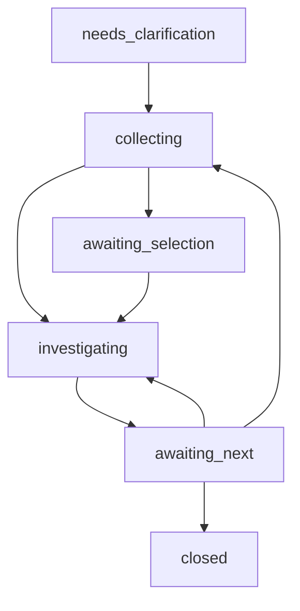

# Алгоритм расследования

[Навигация](README.md) · [API](api.md) · [Каталог проверок](rules.md)

## 1. Уточнение и фиксация области

Определить context, namespace, workload и направление относительно этого workload.
«Из A в B» — outbound A; «к A не может B» — inbound A. Общая жалоба на сеть без
направления требует вопроса. Namespace не угадывается как default.
Owner references ведут от Pod через ReplicaSet к Deployment; prefix имени не
является идентичностью. Поддержать Deployment, StatefulSet, DaemonSet, Pod, selector.

Среди нескольких кандидатов показать выбор. До разрешения неоднозначности не
собирать данные других приложений. При конкретном peer строить пару напрямую.
Порт/протокол уточнять только когда варианты меняют расследуемую связь.

Период — `[start,end)`, RFC3339 с timezone. Relative lookback фиксируется один раз
при создании готовой к сбору попытки. Omitted window → последние 900 секунд.
Сервер возвращает resolved window; пользователю время показывается в его зоне.
Отсутствие сохранённых логов не компенсируется новым периодом без его выбора.

## 2. Начальный сбор и ветка неготовности

1. Зафиксировать pod UID, owner, Pod IP, revision/image metadata, resourceVersion
   и collected_at. Читать containerStatuses и initContainerStatuses: native
   sidecar может находиться среди init containers.
2. Получить Service/EndpointSlice и применимые ресурсы в разрешённом scope.
3. Собрать текущие и доступные previous logs `istio-proxy` всех реплик. По UID и
   времени добавить Kubernetes Events. Не читать другие контейнерные логи.
4. Разделить access events и диагностические сообщения Envoy/pilot-agent.
5. При отсутствующем/not-ready/crash-looping proxy сформировать отдельную ветку
   readiness, даже когда нет access events или недоступен 15000.

Ошибки xDS/JWKS/SDS/CSR/startup являются свидетельствами конкретного механизма
только при успешном распознавании версии/формата и связи с pod. Timeout до istiod
локализует недоступную зависимость, но не доказывает CNI или NetworkPolicy.
Выход к control plane отмечается как причина готовности sidecar; полное
расследование istiod/его логов не добавляется автоматически.

## 3. Очередь связей

Группировать по source → destination, port, protocol. Отдельно хранить сигнатуры,
распределение по pod'ам и последнее событие. Неизвестные identity остаются unknown.
Число строк — observation count, не число уникальных запросов без дедупликации.

Для общей жалобы вернуть список и `awaiting_selection`. Для конкретной пары
сразу перейти к проверке. Если событий нет, проверить доступную конфигурацию и
объяснить отсутствие подтверждения; не возвращать «сеть исправна».

## 4. Проверка выбранного направления

Получить dump всех доступных proxy обеих сторон, используя фиксированные Envoy
GET. Выбирать конкретные pod'ы в port-forward; не обращаться к Service как к
случайной реплике. Correlation использует upstream address, request/trace ID,
время и другие атрибуты совместно. Retry и clock skew могут дать несколько
кандидатов. Не выполнять декартово произведение всех реплик.

Проверить активный путь source listener → filter chain → route/TCP proxy → cluster
→ endpoint, затем destination inbound → локальный upstream приложения. Различать
Service port, targetPort и фактический destination port. Сохранить unknown на
неподдержанном matcher, Lua/Wasm или недостающем Host/SNI/identity.

Проверять active/warming/rejected отдельно. Сравнить реплики, версии, subsets,
политики, endpoints и TLS. Не останавливать расследование на первой находке.
Проверка effective policy должна учитывать применимость, namespace/root scope,
активный фильтр и доступные атрибуты. Неполный scope исключает вывод о полном
разрешении доступа. DNS до sidecar может не оставить access event.

## 5. Причины и прекращение работы

`confirmed` требует свидетельства механизма отказа и надёжной связи с выбранным
событием/участком. `probable` — согласующаяся гипотеза с явно указанным пробелом.
`unknown` — данных недостаточно или доказательства противоречат друг другу.
Результат отдельной проверки PASS/FAIL не равен доказанной причине инцидента.

Остановка допустима при завершении доступных проверок, исчерпании бюджета,
отмене или невозможности получить нужное свидетельство. Повторное чтение
неизменных данных без основания запрещено координатором. Для временного сетевого
сбоя допускается один bounded retry; forbidden/invalid input не повторяются.
Расхождение ссылок при rollout можно перечитать один раз в пределах бюджета.

## 6. ASTRA и контекст продукта

Основная ветка работает независимо от ASTRA. При enabled и выбранном projectId
клиент может запросить зависимости/требования или источники через отдельный tool.
Документированная зависимость без access event отмечается как expected, а не
observed failure. Если она вне cluster-local, описать предел покрытия.
Knowledge result не переписывает вывод rules автоматически. Противоречие версии
документации и работающего образа сохраняется как ограничение.

## 7. Ответ, продолжение и перепроверка

Вернуть краткую причину/неизвестное, область влияния, evidence IDs, рекомендацию,
способ проверки и оставшуюся очередь. `investigated` означает просмотр, не repair.
Подробности выдаются через `get_evidence`, без полного dump по умолчанию.

«Я исправил, проверь» → `refresh_diagnosis` с новым явно заданным окном. Сравнить
попытки по UID/owner, endpoint membership и семантическим полям пути; отделять
изменившуюся конфигурацию, наблюдаемый успех и отсутствие новых запросов.
Изменённая конфигурация без трафика не доказывает устранение сбоя.

Выбранная ранее связь переносится в новую попытку по её семантической identity,
а не по случайному индексу списка. Если сопоставление стало неоднозначным,
возвращается выбор; нельзя объявлять успех сравнения другой связи. Без прежнего
выбора refresh заново строит очередь основного workload в новом окне.

## Состояния

| Действие | Условие | Результат |
|---|---|---|
| start без однозначного ввода | Новая сессия | needs_clarification; question/candidates; сбор не начат |
| start с diagnosis_id | Только needs_clarification | Дополнить запрос; начать collecting при достаточном вводе |
| collecting завершён | Общая жалоба + есть связи | awaiting_selection |
| collecting завершён | Точная пара / readiness / нет событий | investigating доступных проверок |
| investigate_connection | awaiting_selection или awaiting_next | investigating выбранного connection_id |
| job завершён/отменён | Есть частичный или полный результат | awaiting_next; job status хранится отдельно |
| refresh_diagnosis | Нет активного diagnostic job | Новая attempt; collecting; прежняя сохранена |
| close_diagnosis | Любое живое состояние | closed; cleanup jobs/tunnels/evidence |

Session state и job status различаются: job `queued/running/completed/partial/
failed/cancelled`; ошибка отдельного pod не обязательно делает job failed.
Полная отмена начального сбора оставляет awaiting_next с partial/unknown и
возможностью refresh. Внезапный внутренний сбой фиксируется в job, а сессия
остаётся читаемой. Закрытая сессия оставляет краткий tombstone до TTL.
