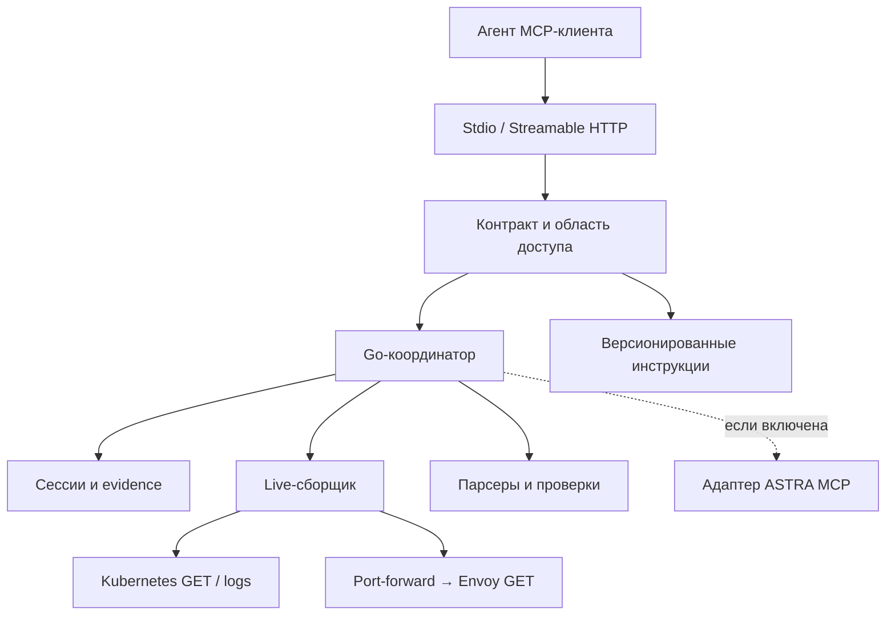

# Архитектура

[Навигация](README.md) · Предлагаемое устройство текущей версии.

## Компоненты и границы

| Компонент | Вход → выход | Ограничения |
|---|---|---|
| Transport | JSON-RPC → типизированный вызов | Go SDK; stdout только MCP; HTTP auth до tool dispatch |
| API | Principal + args → validated command | Проверка ownership, context/namespace scope, состояния, лимитов |
| Coordinator | Command → job и результат | Детерминированная последовательность, bounded retries, отмена |
| Session store | IDs → session/attempt/job/evidence | In-memory, TTL, лимит памяти, изоляция principal |
| Collector | План чтений → observations + coverage | Фиксированный runner без shell; нет произвольных команд/URL |
| Parsers | Proxy logs / Envoy JSON → модели | Версия адаптера, unknown fields, без сетевых вызовов |
| Rules | Модели + контекст связи → checks/findings | Чистые функции; механизм и причинность оцениваются отдельно |
| Playbooks | Module ID + bundle version → текст | Только встроенный каталог, без произвольного файлового пути |
| ASTRA adapter | Product question/source request → knowledge evidence | Optional, отдельный бюджет, scope проекта и очистка контекста |

## Владение данными

Сессия закрепляет principal, разрешённый scope, основной workload и direction.
Попытка закрепляет абсолютное окно логов, версии правил/промптов и состав pod'ов
с UID. Job — конкретная работа внутри попытки. Evidence привязано к attempt,
источнику и времени; сравнение не перезаписывает прежние observations.

Изменение приложения, namespace, context или direction требует новой сессии.
Изменение периода и повторная проверка выбранной связи создают новую попытку.
Повторный сбор никогда не смешивает текущий dump с историческим логом без отметки.

## Работа без серверного LLM

Клиент распознаёт пользовательскую жалобу, уточняет ввод и объясняет результат.
Go валидирует его команды и управляет сбором. Неправильный порядок вызовов не
компенсируется промптом: API возвращает конфликт состояния и допустимые действия.
Ни prompt, ни документация ASTRA, ни строка лога не дают серверу новые операции.

ASTRA может сама выполнять агентный цикл на своей стороне. Нашему адаптеру
достаточно обычного MCP-клиента. Свободный ответ возвращается клиентскому агенту
как knowledge evidence; автоматический evaluator использует только поддержанные
типизированные факты и проверки.

## Выполнение и конкурентность

Сбор идёт с ограниченной параллельностью. Все обнаруженные pod'ы попадают в план;
дедлайн оставляет явные pending/skipped entries, а не уменьшает знаменатель coverage.
У одной сессии одна изменяющая диагностическая операция одновременно. Повторный
operation ID с тем же каноническим вводом возвращает прежний job, с другим — конфликт.
Чтение результата не запускает работу. ASTRA не удерживает блокировку основного
сбора; её отдельный job может выполняться параллельно с чтением результата.

HTTP disconnect не означает отмену серверного job. Клиент продолжает через
`get_diagnosis`; `cancel_operation` отменяет нужную работу явно. Закрытие сессии
отменяет все jobs и закрывает tunnels. SIGTERM stdio-процесса выполняет cleanup.
MCP transport session и diagnosis session имеют разные ID и сроки жизни.

## Изоляция удалённого сервиса

Для HTTP предложен проверяемый OIDC bearer access token с issuer/audience/expiry
и явным сопоставлением `(issuer, subject)` с context и namespace allowlist.
Конкретный issuer и политика выбора kube identity остаются O02 в требованиях.
Нельзя доверять произвольному `X-User` или client-supplied principal.

Все lookup evidence/session/operation повторно проверяют ownership. Чужой и
несуществующий ID возвращают одинаковый not-found. Ключ kubeconfig остаётся
серверным; токен клиента не пересылается в Kubernetes или ASTRA. Выбор другого
context в аргументах не расширяет серверный scope.

## Наблюдаемость сервера

Структурированные внутренние записи: request ID, tool, pseudonymous principal,
session/job ID, длительность, число/объём чтений, статус и причина остановки.
Не записывать полный dump, credentials, содержимое ASTRA question или сырые логи.
Сбой collector, parser и rule evaluator различается в result coverage. Ошибка
внутреннего кода даёт correlation ID, а не stack trace с окружением клиенту.

## Связь с прототипом

Прототип сохранён в архивной ветке, а его cmd/internal удалены из текущего дерева.
Новый server/collector строится по целевым контрактам, без совместимости со старым
snapshot API. Отдельные правила и сценарии из архивного `internal/diagnostics`
можно перенести после проверки семантики и адаптации к новым evidence-моделям.
Границы — session store, log adapters, coordinator, playbooks, ASTRA adapter.
[Описание очистки](rewrite-baseline.md) фиксирует архив и сохранённые артефакты;
порядок реализации компонентов относится к отдельному плану.
